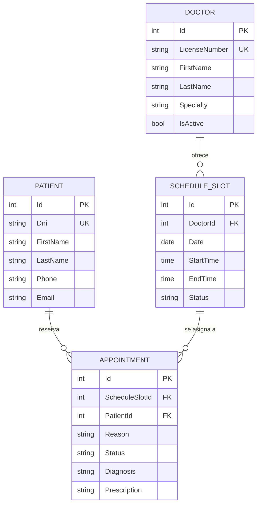
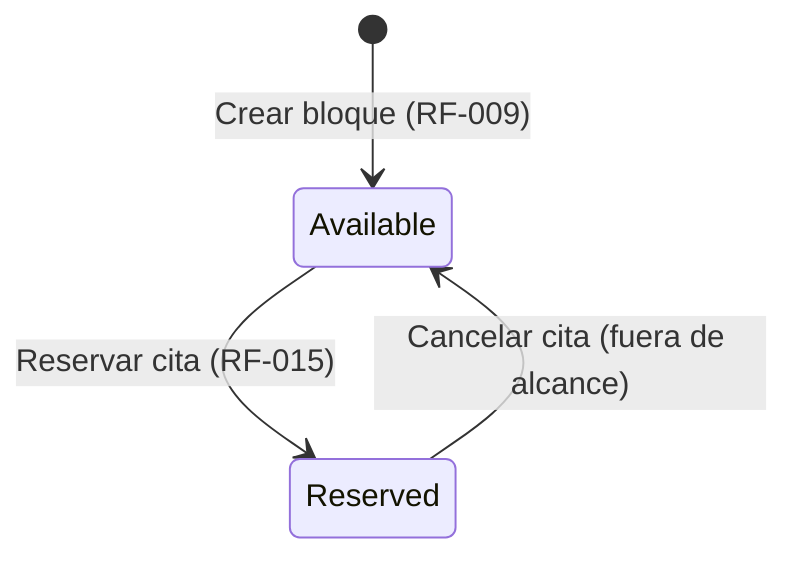
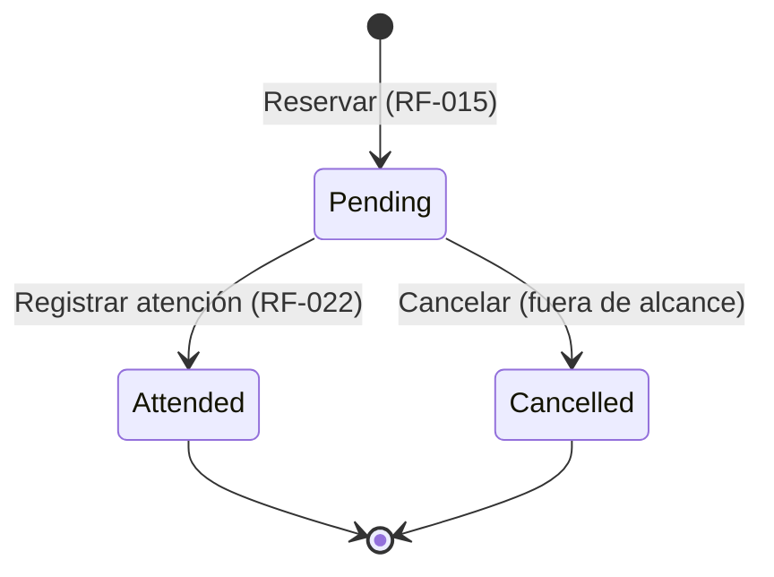

# Modelo de Datos: Núcleo de Citas Médicas

| Campo | Valor |
| :--- | :--- |
| **Feature** | `001-citas-medicas-core` |
| **Especificación** | [spec.md](./spec.md) |
| **Fecha** | 2026-10-07 |
| **Estado** | Borrador (pendiente de aprobación) |

> **Convención de nombres** (CLAUDE.md): la documentación usa términos de dominio en español; los identificadores de código y persistencia van en inglés. Cada tabla de atributos indica ambos.
>
> Los tipos son **lógicos**. El mapeo a tipos SQL Server o a clases C# se define en `plan.md`.

---

## 1. Diagrama Entidad-Relación

> La cardinalidad `SCHEDULE_SLOT ||--o{ APPOINTMENT` deja preparado el modelo para la cancelación futura (un bloque liberado podría reservarse otra vez). En esta feature rige la invariante **INV-03**: como máximo **una cita no cancelada por bloque**.

---

## 2. Entidades

### 2.1 Paciente (`Patient`)

Persona que recibe atención médica. Requisitos: RF-001 – RF-008.

| Atributo (dominio) | Identificador | Tipo lógico | Oblig. | Restricciones | Req. |
| :--- | :--- | :--- | :-: | :--- | :--- |
| Id | `Id` | Entero | Sí | Clave primaria, generada por el sistema | RF-001 |
| Dni | `Dni` | Texto(8) | Sí | Exactamente 8 dígitos numéricos; **único** | RF-002, RF-003 |
| Nombres | `FirstName` | Texto(100) | Sí | No vacío tras recortar espacios | RF-005 |
| Apellidos | `LastName` | Texto(100) | Sí | No vacío tras recortar espacios | RF-005 |
| Teléfono | `Phone` | Texto(20) | Sí | No vacío; dígitos, espacios, `+` y `-` | RF-005 |
| Email | `Email` | Texto(150) | No | Formato de correo válido si se informa | RF-004 |

**Índices**
- `UX_Patient_Dni` (único) sobre `Dni` → RF-002, RF-006.
- `IX_Patient_LastName` sobre `LastName, FirstName` → RF-007 (búsqueda y orden).

---

### 2.2 Médico (`Doctor`)

Profesional de salud que ofrece bloques de agenda. En esta feature se carga como datos iniciales (supuesto 4 de la spec).

| Atributo (dominio) | Identificador | Tipo lógico | Oblig. | Restricciones | Req. |
| :--- | :--- | :--- | :-: | :--- | :--- |
| Id | `Id` | Entero | Sí | Clave primaria | — |
| Colegiatura | `LicenseNumber` | Texto(20) | Sí | **Único**; no vacío | — |
| Nombres | `FirstName` | Texto(100) | Sí | No vacío | RF-026 |
| Apellidos | `LastName` | Texto(100) | Sí | No vacío | RF-026 |
| Especialidad | `Specialty` | Texto(100) | Sí | No vacío | RF-026 |
| Activo | `IsActive` | Booleano | Sí | Por defecto `true` | RF-010, RF-019 |

**Índices**
- `UX_Doctor_LicenseNumber` (único) sobre `LicenseNumber`.

---

### 2.3 Agenda (`ScheduleSlot`)

Bloque horario de un médico en una fecha concreta. Requisitos: RF-009 – RF-014.

| Atributo (dominio) | Identificador | Tipo lógico | Oblig. | Restricciones | Req. |
| :--- | :--- | :--- | :-: | :--- | :--- |
| Id | `Id` | Entero | Sí | Clave primaria | RF-009 |
| MedicoId | `DoctorId` | Entero | Sí | FK → `Doctor.Id`; médico activo al crear | RF-010 |
| Fecha | `Date` | Fecha | Sí | No anterior a la fecha actual al crear | RF-012 |
| HoraInicio | `StartTime` | Hora (hh:mm) | Sí | `StartTime < EndTime` | RF-011 |
| HoraFin | `EndTime` | Hora (hh:mm) | Sí | Exclusiva para el cálculo de solapamiento | RF-011, RF-013 |
| Estado | `Status` | Enumeración `ScheduleSlotStatus` | Sí | Valor inicial `Available` | RF-009, RF-015 |

**Índices**
- `IX_ScheduleSlot_Doctor_Date` sobre `DoctorId, Date, StartTime` → RF-013, RF-014.

---

### 2.4 Cita / Atención (`Appointment`)

Reserva de un paciente sobre un bloque de agenda; al ser atendida almacena los datos clínicos. Requisitos: RF-015 – RF-026.

| Atributo (dominio) | Identificador | Tipo lógico | Oblig. | Restricciones | Req. |
| :--- | :--- | :--- | :-: | :--- | :--- |
| Id | `Id` | Entero | Sí | Clave primaria | RF-015 |
| AgendaId | `ScheduleSlotId` | Entero | Sí | FK → `ScheduleSlot.Id`; bloque *Disponible* al reservar | RF-016, RF-017 |
| PacienteId | `PatientId` | Entero | Sí | FK → `Patient.Id` | RF-017 |
| Motivo | `Reason` | Texto(500) | Sí | No vacío tras recortar espacios | RF-018 |
| EstadoCita | `Status` | Enumeración `AppointmentStatus` | Sí | Valor inicial `Pending` | RF-015, RF-022, RF-024 |
| Diagnóstico | `Diagnosis` | Texto(2000) | Condicional | Nulo mientras `Pending`; **obligatorio** para pasar a `Attended` | RF-022, RF-023 |
| Receta | `Prescription` | Texto(2000) | No | Solo se informa al pasar a `Attended` | RF-022 |

**Índices**
- `IX_Appointment_ScheduleSlot` sobre `ScheduleSlotId` → INV-03.
- `IX_Appointment_Patient` sobre `PatientId` → consultas por paciente.

---

## 3. Enumeraciones

### `ScheduleSlotStatus` (Estado de Agenda)

| Valor (dominio) | Identificador | Descripción |
| :--- | :--- | :--- |
| Disponible | `Available` | Bloque libre que admite reservas. |
| Reservado | `Reserved` | Bloque con una cita no cancelada asociada. |

### `AppointmentStatus` (Estado de Cita)

| Valor (dominio) | Identificador | Descripción |
| :--- | :--- | :--- |
| Pendiente | `Pending` | Cita reservada, aún no atendida. |
| Atendida | `Attended` | Atención registrada; estado final e inmutable. |
| Cancelada | `Cancelled` | Reservado para una feature posterior; sin transición en esta feature. |

---

## 4. Máquinas de Estado

### 4.1 Agenda (`ScheduleSlot.Status`)

### 4.2 Cita (`Appointment.Status`)

**Transiciones permitidas en esta feature**

| Entidad | Desde | Hacia | Disparador | Precondiciones | Req. |
| :--- | :--- | :--- | :--- | :--- | :--- |
| ScheduleSlot | — | `Available` | Crear bloque | Médico activo; rango válido; sin solapamiento; no en el pasado | RF-009 – RF-013 |
| ScheduleSlot | `Available` | `Reserved` | Reservar cita | Médico activo; bloque no iniciado; paciente existe; motivo informado | RF-015 – RF-021 |
| Appointment | — | `Pending` | Reservar cita | Igual que la fila anterior (misma transacción) | RF-015, RF-020 |
| Appointment | `Pending` | `Attended` | Registrar atención | Diagnóstico informado | RF-022 – RF-024 |

Cualquier otra transición debe rechazarse en la capa de Dominio (RF-024, RF-025, RF-027).

---

## 5. Invariantes de Dominio

| ID | Invariante | Req. |
| :--- | :--- | :--- |
| **INV-01** | No existen dos pacientes con el mismo `Dni`. | RF-002 |
| **INV-02** | No existen dos bloques del mismo médico y fecha cuyos intervalos `[StartTime, EndTime)` se intersecten. | RF-013 |
| **INV-03** | Cada `ScheduleSlot` tiene como máximo una `Appointment` con `Status ≠ Cancelled`. | RF-021, CE-002 |
| **INV-04** | `ScheduleSlot.Status = Reserved` ⇔ existe exactamente una `Appointment` no cancelada asociada. | RF-020, CE-003 |
| **INV-05** | `Appointment.Status = Attended` ⇒ `Diagnosis` no es nulo ni vacío. | RF-022, RF-023 |
| **INV-06** | Una `Appointment` en `Attended` no se modifica. | RF-025 |
| **INV-07** | `StartTime < EndTime` en todo `ScheduleSlot`. | RF-011 |

**Regla de solapamiento (INV-02)**: dos bloques A y B del mismo médico y fecha se solapan si `A.StartTime < B.EndTime` **y** `B.StartTime < A.EndTime`. Los bloques contiguos (`A.EndTime = B.StartTime`) no se solapan.

---

## 6. Operaciones Atómicas

Según la Constitución (principio 4), las operaciones que modifican más de una entidad o dependen de una verificación previa se ejecutan dentro de una única transacción a través de los repositorios.

| Operación | Entidades afectadas | Garantía requerida | Req. |
| :--- | :--- | :--- | :--- |
| Reservar cita | `ScheduleSlot` (update) + `Appointment` (insert) | Verificar `Available` y cambiar a `Reserved` de forma atómica, sin que otra transacción pueda reservar el mismo bloque entre la verificación y la escritura | RF-020, RF-021 |
| Crear bloque | `ScheduleSlot` (insert) | Verificar solapamiento e insertar sin que otro bloque solapado se inserte en paralelo | RF-013 |
| Registrar paciente | `Patient` (insert) | Unicidad de DNI garantizada por la persistencia, no solo por validación previa | RF-002 |
| Registrar atención | `Appointment` (update) | Verificar `Pending` y cambiar a `Attended` de forma atómica | RF-022, RF-024 |

---

## 7. Datos Iniciales (Seed)

El catálogo de médicos se precarga para habilitar las pruebas de agenda y reserva. Valores de referencia:

| LicenseNumber | FirstName | LastName | Specialty | IsActive |
| :--- | :--- | :--- | :--- | :-: |
| CMP-012345 | Ana | Torres Vega | Medicina General | `true` |
| CMP-023456 | Luis | Paredes Soto | Pediatría | `true` |
| CMP-034567 | María | Quispe Rojas | Cardiología | `false` |

> El médico inactivo permite verificar RF-010 y RF-019.
