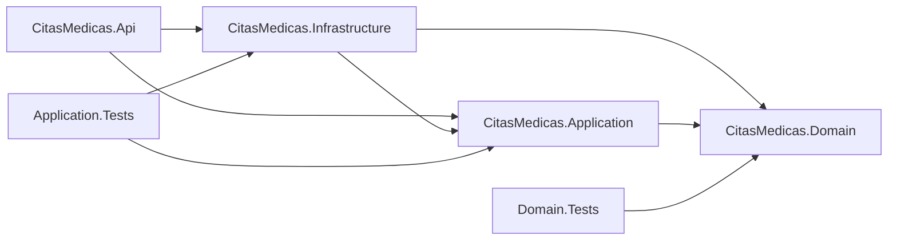
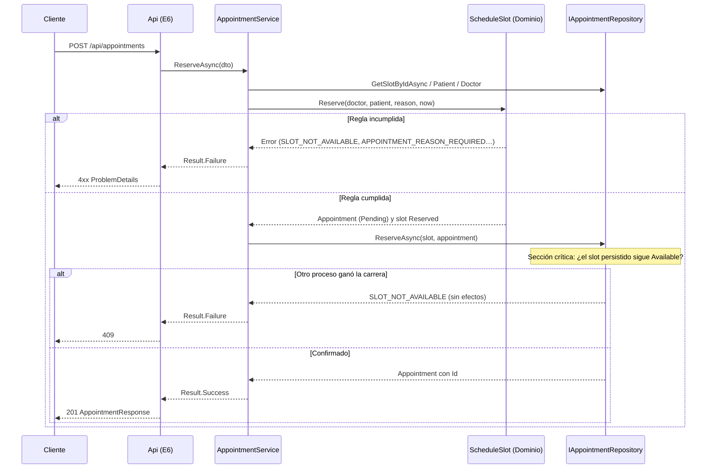

# Plan Técnico: Núcleo de Citas Médicas

| Campo | Valor |
| :--- | :--- |
| **Feature** | `001-citas-medicas-core` |
| **Rama** | `001-citas-medicas-core` |
| **Fecha** | 2026-10-07 |
| **Estado** | Borrador (pendiente de aprobación) |
| **Especificación** | [spec.md](./spec.md) |
| **Artefactos** | [data-model.md](./data-model.md) · [research.md](./research.md) · [contracts/api-contracts.md](./contracts/api-contracts.md) |

---

## 1. Resumen

Se construye una Web API en .NET 10 con arquitectura limpia de 3 capas (Domain, Application, Infrastructure) más un host de presentación delgado (Api). Cubre registro y búsqueda de pacientes, agenda de médicos activos, reserva atómica de citas y registro de atención (RF-001 a RF-029).

Las reglas de agenda y clínicas viven en entidades de Dominio puras y verificables con xUnit. La persistencia de esta fase usa repositorios en memoria detrás de tres contratos (`IPatientRepository`, `IDoctorRepository`, `IAppointmentRepository`), con operaciones atómicas de tipo *compare-and-set* que garantizan la consistencia bajo concurrencia.

---

## 2. Contexto Técnico

| Aspecto | Decisión | Ref. |
| :--- | :--- | :--- |
| Lenguaje / Runtime | C# 13 / .NET 10 (SDK `10.0.401` verificado) | CLAUDE.md |
| Tipo de proyecto | Web API, Minimal APIs | [R-01](./research.md) |
| Arquitectura | Domain ← Application ← Infrastructure; Api como raíz de composición | CLAUDE.md, [R-05](./research.md) |
| Persistencia | Repositorios en memoria (Singleton, `lock` por repositorio) | [R-02](./research.md), [R-03](./research.md) |
| Errores | `Result` / `Error(Code, Message, Kind)` propios → ProblemDetails | [R-06](./research.md) |
| Reloj | `System.TimeProvider` + zona `America/Lima` | [R-07](./research.md) |
| Búsqueda | Normalización sin tildes ni mayúsculas (`TextNormalizer`) | [R-08](./research.md) |
| Fecha y hora | `DateOnly` / `TimeOnly`; DTO `yyyy-MM-dd` / `HH:mm` | [R-09](./research.md) |
| Paquetes NuGet | Solo en proyectos de prueba: `Microsoft.NET.Test.Sdk`, `xunit`, `xunit.runner.visualstudio`, `FluentAssertions` 7.x | [R-10](./research.md) |
| Calidad | `TreatWarningsAsErrors`, `Nullable` habilitado | [R-11](./research.md) |
| Pruebas | `Domain.Tests` (unitarias) + `Application.Tests` (casos de uso y concurrencia) | [R-12](./research.md) |
| Plataforma | Windows (desarrollo); multiplataforma por diseño | — |
| Rendimiento | Búsqueda < 1 s con 10 000 pacientes (CE-005); en memoria es O(n) y cumple holgadamente | spec CE-005 |
| Restricciones | Sin autenticación, sin base de datos, sin OpenAPI | spec §9, [R-10](./research.md) |

---

## 3. Constitution Check

Se evalúa contra [.specify/memory/constitution.md](../../.specify/memory/constitution.md) en dos momentos: **antes** del diseño (sobre la spec) y **después** del diseño (sobre este plan y sus artefactos).

### 3.1 Evaluación

| # | Principio | Pre-diseño | Post-diseño | Evidencia |
| :-: | :--- | :-: | :-: | :--- |
| 1 | **Simplicidad del Stack**: sin paquetes no declarados | ✅ | ✅ | Lista cerrada de 4 paquetes, solo en pruebas ([R-10](./research.md)). Se eliminan `coverlet.collector` y OpenAPI de las plantillas. `Result`, reloj de prueba y normalización son propios. Domain, Application, Infrastructure y Api quedan sin paquetes. |
| 2 | **Spec Manda**: toda implementación responde a un RF | ✅ | ✅ | Cada endpoint, operación de repositorio y código de error referencia un RF ([api-contracts.md](./contracts/api-contracts.md)). La matriz §5 asigna cada RF a sus componentes. No hay endpoints sin RF (no se expone, por ejemplo, un listado de médicos). Ver la observación **H-01**. |
| 3 | **Separación de Responsabilidades**: reglas en Dominio/Servicio | ✅ | ✅ | Las reglas RF-003 a RF-025 están en entidades de Dominio (`Patient`, `ScheduleSlot`, `Appointment`), orquestadas por servicios de Aplicación. La Api solo traduce formatos (`VALIDATION_FORMAT`) y `Result` a HTTP. El repositorio invoca `ScheduleSlot.OverlapsWith` y no duplica la regla ([R-03](./research.md)). |
| 4 | **Persistencia Controlada**: repositorios con transacciones atómicas | ✅ | ✅ | Todo acceso pasa por los 3 contratos ([api-contracts.md §3](./contracts/api-contracts.md)). Las escrituras son atómicas: `ReserveAsync` y `RegisterAttentionAsync` (*compare-and-set*), `AddSlotAsync` (verificación de solapamiento en sección crítica) y `AddAsync` (unicidad de DNI). |
| 5 | **Verificación Automatizada**: `dotnet build` y `dotnet test` con 0 errores | ✅ | ✅ | Dos proyectos de prueba cubren los escenarios de HU-01 a HU-04 y la concurrencia (CE-001 a CE-003). `TreatWarningsAsErrors` endurece el build. Toda tarea de `tasks.md` cerrará con ambos comandos. |

### 3.2 Resultado

> **✅ APROBADO: 5/5 principios cumplidos, sin violaciones.** Hay una observación de consistencia (H-01) que no bloquea el plan, pero requiere tu decisión antes de `/speckit-tasks`.

### 3.3 Observaciones

| ID | Tipo | Hallazgo | Propuesta |
| :--- | :--- | :--- | :--- |
| **H-01** | Consistencia spec ↔ modelo (principio 2) | [data-model.md](./data-model.md) define restricciones **sin RF que las respalde**: longitudes máximas (`Texto(100)`, `Texto(500)`, `Texto(2000)`, etc.) y caracteres permitidos en `Phone` (dígitos, espacios, `+`, `-`). Implementarlas violaría «Spec Manda». | **Opción A (recomendada)**: añadir **RF-030** a la spec: *«Si un campo de texto excede su longitud máxima definida en el modelo de datos, o el teléfono contiene caracteres no permitidos, entonces el sistema deberá rechazar la operación con el error "Formato de campo inválido"»*, con el código `FIELD_FORMAT_INVALID` (400). **Opción B**: retirar esas restricciones del modelo de datos. Mientras no se decida, el plan **no** las implementa. |
| **H-02** | Aclaración (CLAUDE.md, «3 capas») | Se añade el proyecto `CitasMedicas.Api` además de las 3 capas. | No es una capa de negocio: es el host de presentación y la raíz de composición, necesario para exponer la Web API. No contiene reglas (principio 3). Ver §7. |

---

## 4. Estructura del Proyecto

### 4.1 Documentación (esta feature)

```text
specs/001-citas-medicas-core/
├── spec.md                  # Qué y por qué (RF-001 – RF-029)
├── data-model.md            # Entidades, estados, invariantes
├── research.md              # Decisiones técnicas R-01 – R-12
├── plan.md                  # Este documento
├── contracts/
│   └── api-contracts.md     # HTTP + repositorios + catálogo de errores
└── tasks.md                 # (siguiente paso: /speckit-tasks)
```

### 4.2 Código fuente (raíz del repositorio)

```text
CitasMedicas.slnx
Directory.Build.props                      # Nullable, TreatWarningsAsErrors, LangVersion 13 (R-11)

src/
├── CitasMedicas.Domain/                   # Sin dependencias
│   ├── Common/                            # Result, Error, ErrorKind, TextNormalizer
│   ├── Patients/                          # Patient, PatientErrors
│   ├── Doctors/                           # Doctor
│   ├── Scheduling/                        # ScheduleSlot, ScheduleSlotStatus, SchedulingErrors
│   └── Appointments/                      # Appointment, AppointmentStatus, AppointmentErrors
│
├── CitasMedicas.Application/              # → Domain
│   ├── Abstractions/Persistence/          # IPatientRepository, IDoctorRepository, IAppointmentRepository
│   ├── Patients/                          # PatientService, DTOs
│   ├── Scheduling/                        # ScheduleService, DTOs
│   └── Appointments/                      # AppointmentService, DTOs
│
├── CitasMedicas.Infrastructure/           # → Application, Domain
│   ├── Persistence/InMemory/              # InMemoryPatientRepository, InMemoryDoctorRepository,
│   │                                      # InMemoryAppointmentRepository
│   ├── Seed/                              # DoctorSeed (data-model §7)
│   └── DependencyInjection.cs             # AddInfrastructure()
│
└── CitasMedicas.Api/                      # → Application, Infrastructure (raíz de composición)
    ├── Endpoints/                         # PatientEndpoints, ScheduleEndpoints, AppointmentEndpoints
    ├── Http/                              # ResultHttpMapper (Result → ProblemDetails), parsing de formatos
    └── Program.cs

tests/
├── CitasMedicas.Domain.Tests/             # → Domain
│   ├── Patients/PatientTests
│   ├── Scheduling/ScheduleSlotTests       # Rango, pasado, solapamiento, contiguos, reserva
│   └── Appointments/AppointmentTests      # Transiciones Pending→Attended, inmutabilidad
│
└── CitasMedicas.Application.Tests/        # → Application, Infrastructure
    ├── Support/FixedTimeProvider
    ├── Patients/PatientServiceTests       # HU-01
    ├── Scheduling/ScheduleServiceTests    # HU-02
    └── Appointments/                      # HU-03, HU-04
        ├── AppointmentServiceTests
        └── ConcurrentReservationTests     # RF-021, CE-002
```

**Decisión de estructura**: arquitectura limpia con dependencias que solo apuntan hacia el Dominio. Las interfaces de repositorio están en Application ([R-05](./research.md)). `CitasMedicas.Api` es el comando de ejecución definido en CLAUDE.md (`dotnet run --project src/CitasMedicas.Api`).

### 4.3 Grafo de dependencias



---

## 5. Diseño por Capa y Trazabilidad

### 5.1 Dominio: responsabilidades

| Componente | Responsabilidad | Requisitos |
| :--- | :--- | :--- |
| `Patient.Create(...)` | Normaliza (`Trim`) y valida DNI, campos obligatorios y email. Devuelve `Result<Patient>`. | RF-003, RF-004, RF-005 |
| `ScheduleSlot.Create(doctor, date, start, end, now, existingSlots)` | Valida médico activo, rango, no pasado y no solapamiento. Estado inicial `Available`. | RF-009 – RF-013 |
| `ScheduleSlot.OverlapsWith(other)` | Regla `A.Start < B.End && B.Start < A.End`; los bloques contiguos no se solapan. | RF-013, INV-02 |
| `ScheduleSlot.Reserve(doctor, patient, reason, now)` | Verifica `Available`, médico activo, bloque no iniciado y motivo. Pasa a `Reserved` y crea `Appointment` en `Pending`. | RF-015, RF-016, RF-018, RF-019 |
| `Appointment.RegisterAttention(diagnosis, prescription)` | Exige `Pending` y diagnóstico no vacío. Pasa a `Attended`. Sin otros métodos de modificación. | RF-022 – RF-025 |
| `TextNormalizer.ForSearch` | Normalización sin tildes ni mayúsculas. | RF-007 |

### 5.2 Aplicación: casos de uso

| Servicio / Operación | Flujo | Requisitos | Endpoint |
| :--- | :--- | :--- | :--- |
| `PatientService.RegisterAsync` | `Patient.Create` → si el DNI existe, `PATIENT_DNI_DUPLICATE` → `AddAsync` | RF-001 – RF-005 | E1 |
| `PatientService.SearchAsync` | DNI exacto, o apellidos con mínimo 2 caracteres → repositorio | RF-006 – RF-008 | E2, E3 |
| `ScheduleService.CreateSlotAsync` | Obtiene el médico y los bloques del día → `ScheduleSlot.Create` → `AddSlotAsync` | RF-009 – RF-013 | E4 |
| `ScheduleService.GetDoctorScheduleAsync` | `GetSlotsByDoctorAndDateAsync` | RF-014 | E5 |
| `AppointmentService.ReserveAsync` | Obtiene bloque, paciente y médico → `slot.Reserve` → `ReserveAsync` (atómico) | RF-015 – RF-021 | E6 |
| `AppointmentService.RegisterAttentionAsync` | Obtiene la cita → `RegisterAttention` → `RegisterAttentionAsync` (atómico) | RF-022 – RF-025 | E7 |
| `AppointmentService.GetByIdAsync` | Compone la cita con paciente, médico y bloque | RF-026 | E8 |

### 5.3 Flujo crítico: reserva de cita (RF-015 – RF-021)



### 5.4 Matriz RF → componentes → pruebas

| Requisito | Dominio | Aplicación / Repositorio | Prueba |
| :--- | :--- | :--- | :--- |
| RF-001 | — | `PatientService.RegisterAsync`, `AddAsync` | `PatientServiceTests` |
| RF-002 | — | `GetByDniAsync`, `AddAsync` (INV-01) | `PatientServiceTests` |
| RF-003 – RF-005 | `Patient.Create` | — | `PatientTests` |
| RF-006 – RF-008 | `TextNormalizer` | `PatientService.SearchAsync`, `SearchByLastNameAsync` | `PatientServiceTests` |
| RF-009 – RF-012 | `ScheduleSlot.Create` | `ScheduleService.CreateSlotAsync` | `ScheduleSlotTests`, `ScheduleServiceTests` |
| RF-013 | `ScheduleSlot.OverlapsWith` | `AddSlotAsync` (INV-02) | `ScheduleSlotTests`, `ScheduleServiceTests` |
| RF-014 | — | `GetDoctorScheduleAsync` | `ScheduleServiceTests` |
| RF-015 – RF-019 | `ScheduleSlot.Reserve` | `AppointmentService.ReserveAsync` | `ScheduleSlotTests`, `AppointmentServiceTests` |
| RF-020, RF-021 | — | `IAppointmentRepository.ReserveAsync` (INV-03, INV-04) | `ConcurrentReservationTests` |
| RF-022 – RF-025 | `Appointment.RegisterAttention` | `RegisterAttentionAsync` (INV-05, INV-06) | `AppointmentTests`, `AppointmentServiceTests` |
| RF-026 | — | `AppointmentService.GetByIdAsync` | `AppointmentServiceTests` |
| RF-027 | Estructura de capas | Revisión: la Api no contiene reglas | Revisión de código + `Domain.Tests` |
| RF-028 | — | 3 contratos de repositorio | Compilación (Application no referencia Infrastructure) |
| RF-029 | `Error.Code` | Catálogo [api-contracts.md §4](./contracts/api-contracts.md) | Todas las pruebas verifican `code` |

---

## 6. Estrategia de Verificación

| Nivel | Proyecto | Alcance | Criterio |
| :--- | :--- | :--- | :--- |
| Unitario de dominio | `CitasMedicas.Domain.Tests` | **Conflicto de horarios** (solapamiento parcial, contenido, idéntico, contiguo, otro médico, otra fecha), rango inválido, pasado; **reglas de estado de cita** (`Pending→Attended`, rechazo desde `Attended`/`Cancelled`, diagnóstico obligatorio, inmutabilidad); validación de paciente | Sin dependencias; usa `[Theory]` para las tablas de casos |
| Casos de uso | `CitasMedicas.Application.Tests` | Todos los escenarios de aceptación de HU-01 a HU-04 con repositorios en memoria y `FixedTimeProvider` | CE-001 |
| Concurrencia | `ConcurrentReservationTests` | 50 tareas paralelas reservan el mismo bloque: exactamente 1 éxito, 49 `SLOT_NOT_AVAILABLE`, 1 cita y bloque `Reserved` | CE-002, CE-003 |
| Gate de calidad | Solución completa | `dotnet build` y `dotnet test` | 0 errores, 0 advertencias, 0 pruebas fallidas (Constitución §5) |

---

## 7. Seguimiento de Complejidad

No hay violaciones constitucionales que justificar. Se registran las desviaciones respecto de la configuración mínima:

| Elemento | Por qué se necesita | Alternativa más simple descartada |
| :--- | :--- | :--- |
| Proyecto `CitasMedicas.Api` (4.º proyecto de `src`) | Host HTTP y raíz de composición. CLAUDE.md ya lo nombra en «Ejecutar». | Alojar los endpoints en Infrastructure mezcla presentación y persistencia. |
| 2 proyectos de prueba | Separa las pruebas de dominio puras de las pruebas de casos de uso con infraestructura en memoria. | Un único proyecto de pruebas obligaría a `Domain.Tests` a referenciar Infrastructure. |
| *Compare-and-set* en repositorios | Garantiza RF-020, RF-021 y CE-002 bajo concurrencia. | Verificar solo en el Dominio deja una ventana de carrera entre la lectura y la escritura. |

---

## 8. Riesgos

| Riesgo | Impacto | Mitigación |
| :--- | :--- | :--- |
| Migración futura a SQL Server con SPs | El *compare-and-set* y el solapamiento deberán reproducirse en T-SQL | Contratos ya atómicos; patrón SQL documentado en [R-03](./research.md) |
| Licencia de FluentAssertions | v8+ es comercial | Fijar la rama 7.x ([R-10](./research.md)) |
| Zona horaria en el servidor | `America/Lima` no resuelta sin ICU | Lima es UTC−5 fijo; se valida al arrancar y falla rápido si no se resuelve |
| Datos volátiles en memoria | Se pierden al reiniciar | Aceptado en esta fase (spec sin requisito de durabilidad) |

---

## 9. Próximos Pasos

1. **Decidir H-01** (Opción A: añadir RF-030, u Opción B: retirar las restricciones del modelo).
2. Aprobar este plan.
3. Ejecutar `/speckit-tasks` para generar `tasks.md`, con cada tarea referenciando sus RF.
4. Al cerrar la feature: actualizar `CLAUDE.md` con las decisiones transversales (patrón `Result`, *compare-and-set*, lista cerrada de paquetes) y `specs/README.md` con el estado.
