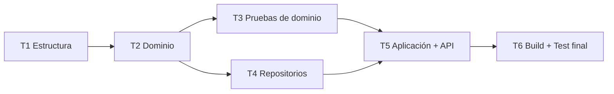

# Tareas: Núcleo de Citas Médicas

| Campo | Valor |
| :--- | :--- |
| **Feature** | `001-citas-medicas-core` |
| **Rama** | `001-citas-medicas-core` |
| **Fecha** | 2026-10-07 |
| **Entradas** | [spec.md](./spec.md) · [plan.md](./plan.md) · [data-model.md](./data-model.md) · [research.md](./research.md) · [api-contracts.md](./contracts/api-contracts.md) · [reglas-atencion.md](./checklists/reglas-atencion.md) |

**Convenciones**
- `[ ]` pendiente · `[x]` completada.
- `[P]`: puede ejecutarse en paralelo con otras subtareas `[P]` de la misma tarea (archivos distintos, sin dependencia).
- Cada subtarea cita los requisitos (RF) que implementa (Constitución §2).
- **Regla de cierre (Constitución §5)**: ninguna tarea T*n* se marca `[x]` sin que `dotnet build` (0 errores, 0 advertencias) y `dotnet test` (0 fallos) pasen en la raíz.

---

## Antes de empezar: decisiones abiertas

Estas decisiones siguen abiertas. Las tareas afectadas están marcadas con ⚠️ y se implementan con el **valor por defecto** indicado hasta que se decida otra cosa.

| ID | Origen | Decisión pendiente | Valor por defecto en estas tareas | Tareas afectadas |
| :--- | :--- | :--- | :--- | :--- |
| H-07 | Checklist | ¿La receta es obligatoria para cerrar la cita? | **Opcional**, como dice la spec vigente (RF-022, Supuesto 3) | T2.8, T3.7, T5.4, T5.9 |
| H-04 | Checklist | Escenario con cita *Cancelada* no alcanzable | Se prueba a **nivel de dominio** reconstruyendo el estado con `Rehydrate` interno (T2.9) | T2.9, T3.7 |
| H-01 | Plan | Longitudes máximas y formato de teléfono sin RF | **No se implementan** | — |
| H-02, H-08 | Checklist | Doble reserva del paciente; cierre antes del horario | **No se implementan** (no están en la spec) | — |
| Estructura de pruebas | Esta solicitud | Un único proyecto `tests/CitasMedicas.Tests` en lugar de los dos de [plan.md §4.2](./plan.md) y [R-12](./research.md) | **Un único proyecto**, con carpetas `Domain/`, `Infrastructure/` y `Application/` | T1.5, T3, T4.6, T5.9 |

- [x] **P-1** Actualizar [plan.md §4.2, §4.3](./plan.md) y [research.md R-12](./research.md) para reflejar el proyecto único `CitasMedicas.Tests` (mantiene la consistencia entre plan y tareas).
- [x] **P-2** Registrar en la spec la decisión sobre H-07; si cambia a «obligatoria», ajustar T2.8, T3.7, T5.4 y T5.9 antes de ejecutarlas.

---

## Orden de dependencias

> T3 y T4 pueden avanzar en paralelo una vez cerrada T2.

---

## T1 — Estructura del proyecto

**Depende de**: — · **Requisitos**: RF-027, RF-028 (estructura de capas) · **Ref.**: [plan.md §4](./plan.md), [R-10](./research.md), [R-11](./research.md)

- [x] **T1.1** Crear la solución `CitasMedicas.slnx` en la raíz (`dotnet new sln -n CitasMedicas`) y un `.gitignore` (`dotnet new gitignore`).
- [x] **T1.2** Crear `Directory.Build.props` en la raíz con `TargetFramework=net10.0`, `LangVersion=13`, `Nullable=enable`, `ImplicitUsings=enable` y `TreatWarningsAsErrors=true` ([R-11](./research.md)).
- [x] **T1.3** [P] Crear las bibliotecas de clases `src/CitasMedicas.Domain`, `src/CitasMedicas.Application` y `src/CitasMedicas.Infrastructure` (`dotnet new classlib`). Eliminar `Class1.cs`.
- [x] **T1.4** [P] Crear `src/CitasMedicas.Api` con `dotnet new webapi --no-openapi`. Eliminar el ejemplo `WeatherForecast` de `Program.cs` y del archivo `.http`.
- [x] **T1.5** [P] Crear `tests/CitasMedicas.Tests` con `dotnet new xunit`. **Quitar** `coverlet.collector`, **agregar** `FluentAssertions` en la última versión 7.x (fija, sin comodines) y eliminar `UnitTest1.cs`.
- [x] **T1.6** Configurar las referencias entre proyectos según [plan.md §4.3](./plan.md):
  - `Application → Domain`
  - `Infrastructure → Application, Domain`
  - `Api → Application, Infrastructure`
  - `Tests → Domain, Application, Infrastructure`
- [x] **T1.7** Agregar los 5 proyectos a `CitasMedicas.slnx` (`dotnet sln add`).

**Criterios de aceptación**
- [x] CA-1.1 `dotnet build` en la raíz termina con **0 errores y 0 advertencias**.
- [x] CA-1.2 `dotnet test` termina con código de salida 0 (aún sin pruebas).
- [x] CA-1.3 `dotnet list package` muestra **exactamente** `Microsoft.NET.Test.Sdk 17.14.1`, `xunit 2.9.3`, `xunit.runner.visualstudio 3.1.4` y `FluentAssertions 7.x`, todos en `CitasMedicas.Tests`. Ningún paquete en `src/` (Constitución §1).
- [x] CA-1.4 `CitasMedicas.Domain.csproj` no contiene `ProjectReference` ni `PackageReference`.
- [x] CA-1.5 `CitasMedicas.Application.csproj` no referencia `Infrastructure` ni `Api` (RF-028).
- [x] CA-1.6 `dotnet run --project src/CitasMedicas.Api` arranca sin errores (comando de CLAUDE.md).

---

## T2 — Dominio: entidades, Value Objects y reglas de validación

**Depende de**: T1 · **Requisitos**: RF-003 – RF-005, RF-007, RF-009 – RF-013, RF-015 – RF-019, RF-022 – RF-025, RF-029 · **Ref.**: [data-model.md](./data-model.md), [plan.md §5.1](./plan.md), [api-contracts.md §4](./contracts/api-contracts.md)

- [x] **T2.1** `Domain/Common`: `ErrorKind { Validation, NotFound, Conflict }`, `Error(Code, Message, Kind)`, `Result` y `Result<T>` con `IsSuccess`, `Value` y `Error` ([R-06](./research.md)). — RF-029
- [x] **T2.2** [P] Catálogos de errores con los códigos y mensajes **exactos** de [api-contracts.md §4](./contracts/api-contracts.md): `Patients/PatientErrors`, `Doctors/DoctorErrors`, `Scheduling/SchedulingErrors`, `Appointments/AppointmentErrors`. — RF-029
- [x] **T2.3** [P] `Common/TextNormalizer.ForSearch`: `Trim`, `Normalize(FormD)`, eliminar `NonSpacingMark` y `ToUpperInvariant` ([R-08](./research.md)). — RF-007
- [x] **T2.4** [P] Value Objects:
  - `Patients/Dni.Create(string)`: aplica `Trim` y exige exactamente 8 caracteres ASCII `0-9`; conserva los ceros a la izquierda. — RF-003
  - `Patients/Email.Create(string?)`: nulo o vacío → sin email; si se informa, valida el formato. — RF-004
  - `Scheduling/TimeRange.Create(TimeOnly start, TimeOnly end)`: exige `start < end`; `Overlaps(other)` con fin exclusivo. — RF-011, RF-013
- [x] **T2.5** `Patients/Patient.Create(dni, firstName, lastName, phone, email)`: usa los VOs, aplica `Trim` y valida los obligatorios (`PATIENT_REQUIRED_FIELD` con el nombre del campo). Devuelve `Result<Patient>`. — RF-001, RF-003 – RF-005
- [x] **T2.6** [P] `Doctors/Doctor`: `Id`, `LicenseNumber`, `FirstName`, `LastName`, `Specialty`, `IsActive`; propiedad `FullName`. — RF-010, RF-019, RF-026
- [x] **T2.7** `Scheduling/ScheduleSlotStatus { Available, Reserved }` y `Scheduling/ScheduleSlot`:
  - `Create(doctor, date, timeRange, now, existingSlots)`: comprueba médico activo, no pasado y no solapamiento; queda en `Available`. — RF-009 – RF-013
  - `OverlapsWith(other)`: mismo médico, misma fecha y `TimeRange.Overlaps`. — RF-013, INV-02
  - `Reserve(doctor, patient, reason, now)`: comprueba `Available`, médico activo, bloque no iniciado y motivo no vacío; pasa a `Reserved` y devuelve `Result<Appointment>` en `Pending`. — RF-015, RF-016, RF-018, RF-019
- [x] **T2.8** ⚠️ H-07 · `Appointments/AppointmentStatus { Pending, Attended, Cancelled }` y `Appointments/Appointment`:
  - `RegisterAttention(diagnosis, prescription?)`: exige `Pending` y diagnóstico no vacío tras `Trim`; pasa a `Attended`. — RF-022, RF-023, RF-024
  - Sin ningún otro método que modifique el estado o los datos clínicos. — RF-025, INV-06
- [x] **T2.9** ⚠️ H-04 · Reconstrucción para persistencia: métodos `internal static Rehydrate(...)` en `Patient`, `Doctor`, `ScheduleSlot` y `Appointment`, más `AssignId(int)` (falla si ya tiene `Id`). Declarar `InternalsVisibleTo` para `CitasMedicas.Infrastructure` y `CitasMedicas.Tests`. Son necesarios para las copias de T4 ([R-03](./research.md)) y para construir una cita `Cancelled` en las pruebas.

**Criterios de aceptación**
- [x] CA-2.1 `dotnet build` con 0 errores y 0 advertencias.
- [x] CA-2.2 `CitasMedicas.Domain` no usa `Task`, `async`, `DateTime.Now`, `TimeProvider` ni tipos de persistencia: la hora actual siempre llega como parámetro `now`.
- [x] CA-2.3 Ninguna propiedad de estado (`Status`, `Diagnosis`, `Prescription`, `IsActive`) tiene un setter público.
- [x] CA-2.4 Ninguna regla de negocio lanza excepciones: todas devuelven `Result` con un `Error.Code` del catálogo.
- [x] CA-2.5 Los 16 códigos de error de negocio de [api-contracts.md §4](./contracts/api-contracts.md) existen en el Dominio con su `Kind` correcto. `VALIDATION_FORMAT` queda para T5.7.

---

## T3 — Pruebas unitarias de reglas clínicas y de agenda

**Depende de**: T2 · **Requisitos**: RF-003 – RF-005, RF-007, RF-009 – RF-013, RF-015 – RF-019, RF-022 – RF-025 · **Ubicación**: `tests/CitasMedicas.Tests/Domain/`

> Convención: cada prueba lleva `[Trait("RF", "RF-0xx")]`; las tablas de casos usan `[Theory]`. Las aserciones verifican `Error.Code`, nunca el mensaje.

- [x] **T3.1** `Support/Builders`: constructores de prueba para `Doctor` (activo e inactivo), `Patient`, `ScheduleSlot` y una fecha y hora `now` fija de referencia.
- [x] **T3.2** [P] `Domain/Patients/DniTests`: válidos `45678912`, `00012345`, ` 45678912 `. Inválidos `1234567`, `123456789`, `4567891A`, `4567 8912`, `""`, `"   "` y dígitos no ASCII (por ejemplo `٤٥٦٧٨٩١٢`) → `PATIENT_DNI_INVALID`. — RF-003
- [x] **T3.3** [P] `Domain/Patients/PatientTests`: registro válido; nombres, apellidos o teléfono vacíos o solo espacios → `PATIENT_REQUIRED_FIELD`; email inválido → `PATIENT_EMAIL_INVALID`; email nulo aceptado. — RF-004, RF-005
- [x] **T3.4** [P] `Domain/Scheduling/TimeRangeTests` (**conflicto de horarios**):

  | Caso | Existente | Nuevo | ¿Solapa? |
  | :--- | :--- | :--- | :-: |
  | Parcial al inicio | 09:00–09:30 | 08:45–09:15 | Sí |
  | Parcial al final | 09:00–09:30 | 09:15–09:45 | Sí |
  | Contenido | 09:00–10:00 | 09:15–09:45 | Sí |
  | Contenedor | 09:15–09:45 | 09:00–10:00 | Sí |
  | Idéntico | 09:00–09:30 | 09:00–09:30 | Sí |
  | Contiguo después | 09:00–09:30 | 09:30–10:00 | No |
  | Contiguo antes | 09:30–10:00 | 09:00–09:30 | No |

  Además: `start == end` y `start > end` → `SLOT_INVALID_TIME_RANGE`. — RF-011, RF-013
- [x] **T3.5** [P] `Domain/Scheduling/ScheduleSlotCreateTests`: creación válida en `Available`; médico inactivo → `DOCTOR_NOT_AVAILABLE`; fecha pasada → `SLOT_IN_PAST`; hoy con hora ya iniciada → `SLOT_IN_PAST`; hoy con hora futura → éxito; solapado con un bloque `Available` o `Reserved` → `SLOT_OVERLAP`; mismo horario con **otro médico** u **otra fecha** → éxito. — RF-009 – RF-013
- [x] **T3.6** [P] `Domain/Scheduling/ScheduleSlotReserveTests`: reserva válida (bloque `Reserved` y cita `Pending` con motivo recortado); bloque ya `Reserved` → `SLOT_NOT_AVAILABLE`; médico inactivo → `SLOT_NOT_AVAILABLE`; bloque iniciado → `SLOT_NOT_AVAILABLE`; motivo vacío o solo espacios → `APPOINTMENT_REASON_REQUIRED`; si falla, el bloque **sigue** `Available`. — RF-015, RF-016, RF-018, RF-019
- [x] **T3.7** [P] ⚠️ H-07, H-04 · `Domain/Appointments/AppointmentTests` (**reglas de estado de cita**):
  - `Pending → Attended` con diagnóstico y receta. — RF-022
  - `Pending → Attended` con diagnóstico y receta nula. — RF-022 (H-07)
  - Diagnóstico vacío o solo espacios → `ATTENTION_DIAGNOSIS_REQUIRED`; el estado sigue `Pending`. — RF-023
  - Desde `Attended` → `APPOINTMENT_NOT_PENDING`; diagnóstico y receta **sin cambios**. — RF-024, RF-025
  - Desde `Cancelled` (construida con `Rehydrate`) → `APPOINTMENT_NOT_PENDING`. — RF-024 (H-04)
- [x] **T3.8** [P] `Domain/Common/TextNormalizerTests`: `Núñez → NUNEZ`, `garcía → GARCIA`, `  Pérez  → PEREZ`. — RF-007

**Criterios de aceptación**
- [x] CA-3.1 `dotnet test` en verde y `dotnet build` con 0 advertencias.
- [x] CA-3.2 `dotnet test --filter "RF=RF-0xx"` devuelve **al menos 1 prueba** para cada uno de: RF-003, RF-004, RF-005, RF-007, RF-009, RF-010, RF-011, RF-012, RF-013, RF-015, RF-016, RF-018, RF-019, RF-022, RF-023, RF-024, RF-025.
- [x] CA-3.3 Las pruebas de `Domain/` no usan repositorios, `TimeProvider` ni `async`.
- [x] CA-3.4 Los 7 casos de solapamiento de T3.4 están en un único `[Theory]`.

---

## T4 — Contratos de repositorio y almacenamiento desacoplado

**Depende de**: T2 · **Requisitos**: RF-001, RF-002, RF-006, RF-007, RF-013, RF-014, RF-017, RF-020, RF-021, RF-024, RF-025, RF-028 · **Ref.**: [api-contracts.md §3](./contracts/api-contracts.md), [R-02](./research.md) – [R-05](./research.md)

- [x] **T4.1** `Application/Abstractions/Persistence`: interfaces `IPatientRepository`, `IDoctorRepository` e `IAppointmentRepository` con las operaciones, entradas y salidas **exactas** de [api-contracts.md §3](./contracts/api-contracts.md). Todas asíncronas y con `CancellationToken`. — RF-028
- [x] **T4.2** [P] `Infrastructure/Persistence/InMemory/InMemoryPatientRepository`:
  - Usa un `lock` y genera los `Id` de forma secuencial.
  - `AddAsync` comprueba la unicidad del DNI dentro del `lock` y, si se repite, devuelve `PATIENT_DNI_DUPLICATE`. — RF-001, RF-002, INV-01
  - `SearchByLastNameAsync` compara con `TextNormalizer.ForSearch` y ordena por `LastName, FirstName`. — RF-007
- [x] **T4.3** [P] `Infrastructure/Seed/DoctorSeed` con los 3 médicos de [data-model.md §7](./data-model.md) e `InMemoryDoctorRepository.GetByIdAsync`. — RF-010, RF-019
- [x] **T4.4** `Infrastructure/Persistence/InMemory/InMemoryAppointmentRepository`:
  - Guarda **copias** (vía `Rehydrate`) y devuelve **copias**; nunca comparte referencias con el llamador. Es imprescindible para el *compare-and-set*.
  - `AddSlotAsync`: dentro del `lock`, vuelve a comprobar `ScheduleSlot.OverlapsWith` contra los bloques del médico y la fecha; si solapa, devuelve `SLOT_OVERLAP`. — RF-013, INV-02
  - `GetSlotsByDoctorAndDateAsync` ordenado por `StartTime`. — RF-014
  - `ReserveAsync`: dentro del `lock`, si el bloque **persistido** sigue `Available`, lo pasa a `Reserved` e inserta la cita; si no, devuelve `SLOT_NOT_AVAILABLE` sin efectos. — RF-020, RF-021, INV-03, INV-04
  - `RegisterAttentionAsync`: confirma solo si la cita **persistida** sigue `Pending`; si no, devuelve `APPOINTMENT_NOT_PENDING`. — RF-024, RF-025
- [x] **T4.5** `Infrastructure/DependencyInjection.AddInfrastructure(IServiceCollection)`: registra los 3 repositorios como *Singleton*.
- [x] **T4.6** [P] Pruebas en `tests/CitasMedicas.Tests/Infrastructure/`:
  - `InMemoryPatientRepositoryTests`: DNI duplicado; 20 altas concurrentes con el mismo DNI → exactamente 1 éxito; búsqueda «nunez» encuentra «Núñez»; orden correcto; búsqueda sin coincidencias → lista vacía. — RF-002, RF-006, RF-007
  - `InMemoryAppointmentRepositoryTests`: modificar un objeto devuelto no altera lo almacenado; `AddSlotAsync` concurrente con bloques solapados → 1 éxito; `RegisterAttentionAsync` dos veces → la segunda devuelve `APPOINTMENT_NOT_PENDING`. — RF-013, RF-025
  - `ConcurrentReservationTests`: **50 tareas** en paralelo reservan el mismo bloque → exactamente **1** éxito, **49** `SLOT_NOT_AVAILABLE`, **1** cita almacenada y el bloque en `Reserved`. — RF-020, RF-021, CE-002, CE-003

**Criterios de aceptación**
- [x] CA-4.1 `dotnet build` y `dotnet test` en verde.
- [x] CA-4.2 Las firmas de las 3 interfaces coinciden una a una con [api-contracts.md §3](./contracts/api-contracts.md) (11 operaciones en total).
- [x] CA-4.3 `ConcurrentReservationTests` pasa **10 ejecuciones consecutivas** sin fallos (`dotnet test --filter "FullyQualifiedName~ConcurrentReservation"` repetido).
- [x] CA-4.4 Ningún repositorio contiene reglas propias: el solapamiento se evalúa invocando `ScheduleSlot.OverlapsWith` (Constitución §3).
- [x] CA-4.5 `Application` no referencia `Infrastructure` (RF-028).

---

## T5 — Casos de uso y endpoints Web API

**Depende de**: T3, T4 · **Requisitos**: RF-001 – RF-029 · **Ref.**: [plan.md §5.2, §5.3](./plan.md), [api-contracts.md §2](./contracts/api-contracts.md), [R-01](./research.md), [R-07](./research.md), [R-09](./research.md)

### Aplicación

- [x] **T5.1** [P] DTOs en `Application/{Patients,Scheduling,Appointments}`: `RegisterPatientRequest`, `PatientResponse`, `CreateScheduleSlotRequest`, `ScheduleSlotResponse`, `ReserveAppointmentRequest`, `RegisterAttentionRequest` y `AppointmentResponse` (con `patient`, `doctor` y `slot` anidados), tal como en [api-contracts.md §2](./contracts/api-contracts.md).
- [x] **T5.2** [P] `Application/Common/ClinicClock`: obtiene la hora local de la clínica a partir de `TimeProvider` y `TimeZoneInfo` `America/Lima` ([R-07](./research.md)). — RF-012, RF-019
- [x] **T5.3** `PatientService`:
  - `RegisterAsync`: si el DNI ya existe, devuelve `PATIENT_DNI_DUPLICATE`; luego `Patient.Create` y `AddAsync`. — RF-001 – RF-005
  - `SearchByDniAsync` / `SearchByLastNameAsync`: el criterio por apellidos exige mínimo 2 caracteres tras `Trim` (si no, `SEARCH_CRITERIA_TOO_SHORT`). — RF-006 – RF-008
- [x] **T5.4** ⚠️ H-07 · Servicios de agenda y citas:
  - `ScheduleService.CreateSlotAsync`: lee el médico (`DOCTOR_NOT_AVAILABLE` si no existe) y los bloques del día, llama a `ScheduleSlot.Create` y luego a `AddSlotAsync`. — RF-009 – RF-013
  - `ScheduleService.GetDoctorScheduleAsync`. — RF-014
  - `AppointmentService.ReserveAsync`: devuelve `SLOT_NOT_FOUND` o `PATIENT_NOT_FOUND` si no existen; luego `slot.Reserve` y `ReserveAsync`. — RF-015 – RF-021
  - `AppointmentService.RegisterAttentionAsync`: devuelve `APPOINTMENT_NOT_FOUND` si no existe; luego `RegisterAttention` y `RegisterAttentionAsync`. — RF-022 – RF-025
  - `AppointmentService.GetByIdAsync`: compone la cita con paciente, médico y bloque. — RF-026
- [x] **T5.5** `Application/DependencyInjection.AddApplication(IServiceCollection)`: registra los servicios y `ClinicClock`.

### API

- [x] **T5.6** `Api/Program.cs`:
  - Llama a `AddApplication()` y `AddInfrastructure()`, y registra `TimeProvider.System`.
  - Serializa JSON en `camelCase` y los enums como cadena con `JsonStringEnumConverter`.
  - Si `America/Lima` no se resuelve al arrancar, falla de inmediato ([plan.md §8](./plan.md)).
- [x] **T5.7** `Api/Http`:
  - `ResultHttpMapper`: `Validation → 400`, `NotFound → 404`, `Conflict → 409`, con `ProblemDetails` que incluya la extensión `code`.
  - Conversión de `yyyy-MM-dd` y `HH:mm`.
  - `VALIDATION_FORMAT` para formatos inválidos y para búsquedas con `dni` y `lastName` a la vez, o con ninguno. — RF-029, [R-09](./research.md)
- [x] **T5.8** `Api/Endpoints` con `MapGroup`: `PatientEndpoints` (E1–E3), `ScheduleEndpoints` (E4–E5) y `AppointmentEndpoints` (E6–E8). Cada endpoint solo **convierte la entrada → invoca el servicio → mapea el `Result`**. — RF-001 – RF-026
- [x] **T5.9** [P] ⚠️ H-07 · Pruebas en `tests/CitasMedicas.Tests/Application/` con repositorios en memoria reales y `Support/FixedTimeProvider : TimeProvider`. Cubren **todos** los escenarios de aceptación, cada uno marcado con `[Trait("HU", "HU-0x")]` y `[Trait("RF", …)]`:
  - `PatientServiceTests`: HU-01 escenarios 1–5. RF-008 con el criterio «G» → `SEARCH_CRITERIA_TOO_SHORT`.
  - `ScheduleServiceTests`: HU-02 escenarios 1–5 y RF-014 (orden por hora de inicio).
  - `AppointmentServiceTests`: HU-03 escenarios 1, 2, 3 y 5 (el escenario 4 lo cubre T4.6); HU-04 escenarios 1–4; RF-026 (composición completa).
- [x] **T5.10** [P] `src/CitasMedicas.Api/CitasMedicas.Api.http`: solicitudes de ejemplo para E1–E8, incluidos los casos de error 400, 404 y 409, para la verificación manual.

**Criterios de aceptación**
- [x] CA-5.1 `dotnet build` y `dotnet test` en verde.
- [x] CA-5.2 Hay **8 endpoints** con las rutas, métodos y códigos HTTP de [api-contracts.md §2](./contracts/api-contracts.md); no existe ningún endpoint adicional (Constitución §2).
- [x] CA-5.3 Los archivos de `Api/Endpoints` no contienen condiciones sobre `Status`, `IsActive`, fechas ni horarios: solo convierten, delegan y mapean (Constitución §3, RF-027).
- [x] CA-5.4 `VALIDATION_FORMAT` es el único código de error creado en `CitasMedicas.Api`.
- [x] CA-5.5 `dotnet test --filter "HU=HU-01"` (y lo mismo para HU-02, HU-03 y HU-04) devuelve al menos tantas pruebas como escenarios tiene la historia (5, 5, 4 + concurrencia, 4) (CE-001).
- [x] CA-5.6 Con la API en ejecución, las solicitudes del archivo `.http` producen los códigos HTTP y el campo `code` esperados.

---

## T6 — Compilación completa y validación final

**Depende de**: T5 · **Requisitos**: RF-001 – RF-029, CE-001 – CE-006 · **Ref.**: Constitución §5

- [x] **T6.1** Ejecutar `dotnet build` en la raíz partiendo de un estado limpio (`dotnet clean` antes).
- [x] **T6.2** Ejecutar `dotnet test` en la raíz.
- [x] **T6.3** Comprobar la trazabilidad: para cada RF con regla verificable (RF-001 – RF-026, RF-029), `dotnet test --filter "RF=RF-0xx"` devuelve al menos 1 prueba.
- [x] **T6.4** Prueba de humo: `dotnet run --project src/CitasMedicas.Api` y ejecutar el flujo completo del archivo `.http`: registrar paciente (E1) → crear bloque (E4) → reservar (E6) → registrar atención (E7) → consultar (E8).
- [x] **T6.5** Comprobar la lista cerrada de paquetes con `dotnet list package` (sin cambios respecto de CA-1.3).
- [x] **T6.6** Cierre documental ([plan.md §9](./plan.md)): actualizar `CLAUDE.md` con las decisiones transversales (patrón `Result`, *compare-and-set*, copias en repositorios en memoria, lista cerrada de paquetes) y `specs/README.md` con el estado **Implementado**.

**Criterios de aceptación**
- [x] CA-6.1 `dotnet build`: **0 errores, 0 advertencias**.
- [x] CA-6.2 `dotnet test`: **0 fallos, 0 omitidas**; total de pruebas mayor que 0.
- [x] CA-6.3 La comprobación T6.3 no deja ningún RF sin prueba.
- [x] CA-6.4 El flujo de humo devuelve `201 → 201 → 201 → 200 → 200` y la cita final está en `Attended`.
- [x] CA-6.5 Las tareas T1 a T5 están marcadas `[x]` solo después de cumplir CA-6.1 y CA-6.2.

---

## Matriz de Cobertura RF → Tareas (CE-006)

| Requisito | Implementación | Pruebas |
| :--- | :--- | :--- |
| RF-001 | T2.5, T4.2, T5.3, T5.8 | T5.9 |
| RF-002 | T4.2, T5.3 | T4.6, T5.9 |
| RF-003 | T2.4, T2.5 | T3.2 |
| RF-004 | T2.4, T2.5 | T3.3 |
| RF-005 | T2.5 | T3.3 |
| RF-006 | T4.2, T5.3, T5.8 | T4.6, T5.9 |
| RF-007 | T2.3, T4.2, T5.3 | T3.8, T4.6, T5.9 |
| RF-008 | T5.3 | T5.9 |
| RF-009 | T2.7, T5.4, T5.8 | T3.5, T5.9 |
| RF-010 | T2.7, T4.3, T5.4 | T3.5, T5.9 |
| RF-011 | T2.4, T2.7 | T3.4, T5.9 |
| RF-012 | T2.7, T5.2 | T3.5, T5.9 |
| RF-013 | T2.4, T2.7, T4.4 | T3.4, T3.5, T4.6, T5.9 |
| RF-014 | T4.4, T5.4, T5.8 | T5.9 |
| RF-015 | T2.7, T5.4, T5.8 | T3.6, T5.9 |
| RF-016 | T2.7 | T3.6, T5.9 |
| RF-017 | T5.4 | T5.9 |
| RF-018 | T2.7 | T3.6, T5.9 |
| RF-019 | T2.7, T5.2 | T3.6 |
| RF-020 | T4.4 | T4.6 |
| RF-021 | T4.4 | T4.6 |
| RF-022 | T2.8, T5.4, T5.8 | T3.7, T5.9 |
| RF-023 | T2.8 | T3.7, T5.9 |
| RF-024 | T2.8, T4.4 | T3.7, T4.6, T5.9 |
| RF-025 | T2.8, T4.4 | T3.7, T4.6, T5.9 |
| RF-026 | T5.4, T5.8 | T5.9 |
| RF-027 | T1.6, T5.8 | CA-5.3 (revisión) |
| RF-028 | T1.6, T4.1 | CA-1.5, CA-4.5 |
| RF-029 | T2.1, T2.2, T5.7 | Todas (aserción sobre `code`) |

> Los 29 requisitos tienen al menos una tarea de implementación y una verificación asociada.
