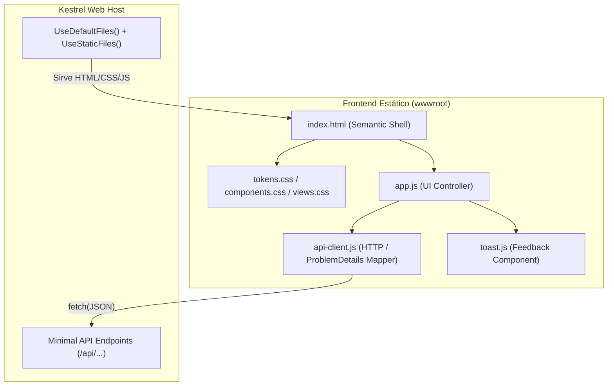

# Plan Técnico: Interfaz Web de Citas Médicas

| Campo | Valor |
| :--- | :--- |
| **Feature** | `002-interfaz-web-citas` |
| **Rama** | `002-interfaz-web-citas` |
| **Fecha** | 2026-10-15 |
| **Estado** | Borrador (Fase de Planificación) |
| **Especificación** | [spec.md](./spec.md) |
| **Contratos Backend** | [api-contracts.md](../001-citas-medicas-core/contracts/api-contracts.md) |

---

## 1. Resumen y Enfoque Arquitectónico

El objetivo es proveer una interfaz visual completa, moderna y ergonómica servida directamente por el backend de ASP.NET Core en `src/CitasMedicas.Api/wwwroot`, sin añadir librerías ni dependencias pesadas (Vanilla JS + Vanilla CSS con arquitectura de tokens de diseño).

La solución se estructura como una **Single Page Application (SPA) basada en componentes modulares limpios**, consumiendo los 8 endpoints existentes bajo la ruta `/api`.



---

## 2. Configuración del Servidor Web (.NET 10 Kestrel)

Para exponer el frontend estático sin alterar ninguna regla clínica ni paquete NuGet, `src/CitasMedicas.Api/Program.cs` incorporará los middlewares nativos de ASP.NET Core:

```csharp
// Program.cs
app.UseDefaultFiles();
app.UseStaticFiles();
```

- `UseDefaultFiles()`: Redirige automáticamente las solicitudes a la raíz (`http://localhost:5290/`) hacia `index.html`.
- `UseStaticFiles()`: Sirve los recursos de `wwwroot` (`.html`, `.css`, `.js`, `.svg`) con cabeceras `Content-Type` y caché optimizadas.
- **Sin paquetes adicionales**: Ambos métodos forman parte del framework `Microsoft.AspNetCore.App` ya referenciado.

---

## 3. Arquitectura de Archivos en `wwwroot`

```text
src/CitasMedicas.Api/wwwroot/
├── index.html                   # Contenedor principal de la SPA, cabecera de tabs y viewport
├── css/
│   ├── tokens.css               # Design Tokens: variables CSS de color, tipografía, espaciado y sombras
│   ├── components.css           # Botones, inputs, badges de estado, cards, modal y toast
│   └── views.css                # Estructuras de vista: agenda grid, reserva y panel de atención
└── js/
    ├── api-client.js            # Wrapper de fetch tipado con normalización de errores ProblemDetails
    ├── toast.js                 # Servicio de alertas visuales accesible y flotante
    └── app.js                   # Orquestador: navegación por pestañas, eventos de formulario y renderizado
```

---

## 4. Sistema Visual y Design Tokens (WCAG AA)

Se define un sistema de diseño clínico, moderno y sobrio basado en custom properties de CSS:

| Token CSS | Valor | Propósito | Ratio de Contraste |
| :--- | :--- | :--- | :---: |
| `--color-primary` | `#2563EB` (Blue 600) | Identidad clínica, botones primarios, enlaces activos | 4.8:1 s/ blanco |
| `--color-primary-hover` | `#1D4ED8` (Blue 700) | Estados hover de elementos primarios | 6.2:1 s/ blanco |
| `--color-bg-app` | `#F8FAFC` (Slate 50) | Fondo limpio general de la aplicación | — |
| `--color-surface` | `#FFFFFF` | Fondo de tarjetas, formularios y modales | — |
| `--color-border` | `#E2E8F0` (Slate 200) | Límites estructurales y divisores | — |
| `--color-text-main` | `#0F172A` (Slate 900) | Encabezados, títulos y texto regular | 16.1:1 s/ fondo |
| `--color-text-muted` | `#64748B` (Slate 500) | Etiquetas secundarias, placeholders y metadatos | 4.7:1 s/ fondo |
| `--status-available-text` | `#16A34A` (Green 600) | Píldora de estado Disponible / Atendida | 4.6:1 s/ Green 100 |
| `--status-available-bg` | `#DCFCE7` (Green 100) | Fondo de píldora Disponible / Atendida | — |
| `--status-pending-text` | `#B45309` (Amber 700) | Píldora de estado Pendiente | 4.5:1 s/ Amber 100 |
| `--status-pending-bg` | `#FEF3C7` (Amber 100) | Fondo de píldora Pendiente | — |
| `--status-reserved-text` | `#DC2626` (Red 600) | Píldora de estado Reservado / Conflicto | 4.5:1 s/ Red 100 |
| `--status-reserved-bg` | `#FEE2E2` (Red 100) | Fondo de píldora Reservado | — |
| `--radius-sm` / `md` / `lg` | `4px` / `8px` / `12px` | Bordes redondeados estandarizados | — |

---

## 5. Mapa de Vistas y Mapeo con Endpoints

### Vista 1: Agenda Médica (`#tab-agenda`)
- **Componentes**: Selector de Médico (Doctor 1, 2, 3), Selector de Fecha (`DateOnly`), Botón "+ Nuevo Bloque", Grilla de Horarios.
- **Endpoints Consumidos**:
  - `GET /api/doctors/{id}/schedule-slots?date={fecha}` (E5)
  - `POST /api/doctors/{id}/schedule-slots` (E4)
- **Interacción**: Al cambiar doctor o fecha se recarga automáticamente la grilla. Un modal accesible permite agregar bloques indicando hora inicio y fin.

### Vista 2: Pacientes y Reserva de Citas (`#tab-reservas`)
- **Componentes**:
  - Buscador dual: Input para DNI (8 dígitos) o Apellidos (mínimo 2 caracteres).
  - Tarjeta de Paciente Encontrado o Formulario desplegable de "Nuevo Paciente".
  - Selector de Bloque Disponible (cargado desde la agenda del día).
  - Input para "Motivo de la Cita" y Botón "Confirmar Reserva".
- **Endpoints Consumidos**:
  - `GET /api/patients?dni={dni}` (E2)
  - `GET /api/patients?lastName={texto}` (E3)
  - `POST /api/patients` (E1)
  - `POST /api/appointments` (E6)
- **Interacción**: El usuario busca el paciente o lo registra; luego selecciona un bloque disponible y confirma la cita atómicamente.

### Vista 3: Atención Clínica (`#tab-atencion`)
- **Componentes**:
  - Input de búsqueda de Cita por ID y Botón "Cargar Cita".
  - Resumen clínico: Paciente, DNI, Médico, Horario y Motivo.
  - Textarea para "Diagnóstico" (obligatorio).
  - Textarea para "Receta Médica" (opcional).
  - Botón "Registrar y Cerrar Atención" (deshabilitado si la cita ya está `Atendida`).
- **Endpoints Consumidos**:
  - `GET /api/appointments/{id}` (E8)
  - `POST /api/appointments/{id}/attention` (E7)
- **Interacción**: Si la cita está `Pending`, permite escribir el diagnóstico y receta. Al guardar, se refresca a estado `Attended` y se bloquea la edición.

---

## 6. Cliente de API y Gestión de Errores

El módulo `api-client.js` gestiona todas las llamadas HTTP mediante `fetch`:
- Asigna cabeceras `Content-Type: application/json; charset=utf-8`.
- Deserializa respuestas JSON tanto en éxito (200, 201) como en error (400, 404, 409).
- Extrae el formato estándar `ProblemDetails` (`title`, `detail`, `code`) y genera objetos de error descriptivos listos para enviar al servicio de `Toast`.
