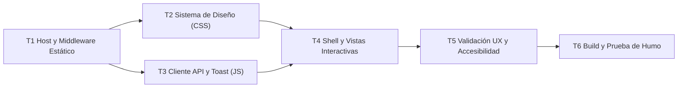

# Tareas: Interfaz Web de Citas Médicas

| Campo | Valor |
| :--- | :--- |
| **Feature** | `002-interfaz-web-citas` |
| **Rama** | `002-interfaz-web-citas` |
| **Fecha** | 2026-10-15 |
| **Entradas** | [spec.md](./spec.md) · [plan.md](./plan.md) · [ux-checklist.md](./checklists/ux-checklist.md) · [api-contracts.md](../001-citas-medicas-core/contracts/api-contracts.md) |

**Convenciones**
- `[ ]` pendiente · `[x]` completada.
- `[P]`: puede ejecutarse en paralelo con otras subtareas `[P]` de la misma tarea (archivos distintos, sin dependencia).
- Cada subtarea cita los requisitos (`RF-WEB-xxx`) y criterios UX que implementa (Constitución §2).
- **Regla de cierre (Constitución §5)**: ninguna tarea T*n* se marca `[x]` sin que `dotnet build` (0 errores, 0 advertencias) y `dotnet test` (0 fallos) pasen en la raíz.

---

## Orden de dependencias

---

## T1 — Configuración del Host y Servidor de Archivos Estáticos

**Depende de**: — · **Requisitos**: RF-WEB-001 · **Ref.**: [plan.md §2](./plan.md)

- [x] **T1.1** Habilitar `app.UseDefaultFiles()` y `app.UseStaticFiles()` en `src/CitasMedicas.Api/Program.cs` antes de los mapeos de endpoints, sin alterar ninguna regla clínica ni agregar paquetes NuGet.
- [x] **T1.2** Crear la estructura de directorios en `src/CitasMedicas.Api/wwwroot/`:
  - `wwwroot/css/`
  - `wwwroot/js/`
- [x] **T1.3** Crear un archivo inicial `wwwroot/index.html` de prueba para verificar que el servidor Kestrel responda con `200 OK` y cabecera `Content-Type: text/html` en la raíz `http://localhost:5290/`.

**Criterios de aceptación**
- [x] CA-1.1 `dotnet build` en la raíz termina con 0 errores y 0 advertencias.
- [x] CA-1.2 `dotnet test` pasa con 102/102 pruebas en verde.
- [x] CA-1.3 Solicitud HTTP `GET http://localhost:5290/` devuelve el archivo HTML con status 200.

---

## T2 — Sistema Visual y Design Tokens (CSS)

**Depende de**: T1 · **Requisitos**: RF-WEB-002, RF-WEB-013 · **Ref.**: [plan.md §4](./plan.md), [ux-checklist.md UX-01 a UX-05](./checklists/ux-checklist.md)

- [x] **T2.1** `wwwroot/css/tokens.css`:
  - Variables de color con contraste WCAG AA: Azul primario (`#2563EB`, hover `#1D4ED8`), Fondo (`#F8FAFC`), Superficie Card (`#FFFFFF`), Bordes (`#E2E8F0`), Texto (`#0F172A`, `#64748B`).
  - Paleta de estados clínicos: Verde Disponible/Atendida (`#16A34A` / `#DCFCE7`), Ámbar Pendiente (`#B45309` / `#FEF3C7`), Rojo Reservado (`#DC2626` / `#FEE2E2`).
  - Tipografía del sistema (`system-ui, -apple-system, 'Segoe UI', Roboto, sans-serif`), escala modular de tamaños y radios de borde (`4px`, `8px`, `12px`).
- [x] **T2.2** [P] `wwwroot/css/components.css`:
  - Botones (`.btn`, `.btn-primary`, `.btn-secondary`, `.btn-outline`, estado `.is-loading`).
  - Inputs y formularios (`.form-group`, `.form-input`, `.form-select`, `.form-error-text`, estado `:focus-visible`).
  - Píldoras de estado (`.badge`, `.badge-available`, `.badge-pending`, `.badge-reserved`, `.badge-attended`).
  - Tarjetas (`.card`) y contenedor de estados vacíos (`.empty-state`).
  - Componente Toast flotante accesible (`.toast-container`, `.toast`, `.toast-success`, `.toast-error`, `.toast-warning`).
- [x] **T2.3** [P] `wwwroot/css/views.css`:
  - Layout responsive general (Navbar superior, Header con Tabs, Contenedor principal con max-width).
  - Grilla de agenda con altura fija de celda y alineación uniforme (`.slots-grid`, `.slot-card`).
  - Layouts de dos columnas para formulario de reserva y panel de atención clínica.
  - Breakpoints responsive Mobile (< 640px) y Tablet/Desktop (> 768px).

**Criterios de aceptación**
- [x] CA-2.1 Ratio de contraste de texto principal contra fondo supera 4.5:1 (alcanza 16:1).
- [x] CA-2.2 Inputs y botones tienen indicadores visibles de foco de 2px para navegación con teclado.
- [x] CA-2.3 Todos los componentes de UI tienen alturas mínimas táctiles de 44px en pantallas móviles.

---

## T3 — Cliente API y Manejo de Notificaciones (JavaScript)

**Depende de**: T1 · **Requisitos**: RF-WEB-005, RF-WEB-006, RF-WEB-012 · **Ref.**: [plan.md §6](./plan.md), [ux-checklist.md UX-15 a UX-16](./checklists/ux-checklist.md)

- [x] **T3.1** `wwwroot/js/toast.js`:
  - Servicio singleton `Toast.show(message, type, title, code)`.
  - Animación de entrada/salida suave, cierre manual y temporizador de 4 segundos con pausa en `:hover`.
  - Renderizado explícito del código de negocio (`code`) en mensajes de error para trazabilidad.
- [x] **T3.2** `wwwroot/js/api-client.js`:
  - Módulo con métodos asíncronos para los 8 endpoints:
    - Pacientes: `registerPatient`, `searchPatientByDni`, `searchPatientsByLastName`.
    - Agenda: `getDoctorSlots`, `createScheduleSlot`.
    - Citas: `reserveAppointment`, `registerAttention`, `getAppointmentById`.
  - Normalización de cabeceras UTF-8 y deserialización segura de JSON.
  - Intercepción centralizada de respuestas de error `ProblemDetails` (400, 404, 409) lanzando excepciones estructuradas `{ status, title, detail, code }`.

**Criterios de aceptación**
- [x] CA-3.1 Las respuestas de error 400, 404 y 409 del backend se capturan y devuelven como objetos homogéneos con su campo `code`.
- [x] CA-3.2 Los toasts se renderizan en una capa superior (`z-index: 1000`) sin alterar el flujo del documento.

---

## T4 — Vistas y Flujos de Interacción SPA

**Depende de**: T2, T3 · **Requisitos**: RF-WEB-003, RF-WEB-004, RF-WEB-007, RF-WEB-008, RF-WEB-009, RF-WEB-010, RF-WEB-011 · **Ref.**: [plan.md §5](./plan.md)

- [x] **T4.1** `wwwroot/index.html`:
  - Estructura semántica HTML5 (`<header>`, `<nav>`, `<main>`, `<section>`).
  - Barra de navegación con 3 pestañas:
    - `Tab 1`: Agenda Médica (`#tab-agenda`)
    - `Tab 2`: Pacientes & Reservas (`#tab-reservas`)
    - `Tab 3`: Atención Clínica (`#tab-atencion`)
  - Contenedor para modales accesibles y contenedor de notificaciones toast.
- [x] **T4.2** [P] `wwwroot/js/app.js` — Módulo de Agenda Médica (Vista 1):
  - Inicialización del selector de médicos con los 3 doctores del seed (Dra. Ana Torres, Dr. Luis Paredes, Dra. María Quispe).
  - Inicialización de fecha con el día actual local (`America/Lima`).
  - Consulta y renderizado de tarjetas de bloques con badge `Disponible` o `Reservado` (RF-WEB-003, RF-WEB-009).
  - Modal o formulario de creación de bloque con validación en cliente de `startTime < endTime` (RF-WEB-004).
- [x] **T4.3** [P] `wwwroot/js/app.js` — Módulo de Pacientes y Reserva (Vista 2):
  - Buscador dual interactivo: radio/pestaña para DNI o Apellidos, con validación de mínimo 2 caracteres para apellidos (RF-WEB-005, RF-WEB-006).
  - Formulario de registro de nuevo paciente con validación estricta de DNI (8 dígitos) y campos obligatorios (RF-WEB-007).
  - Sección de reserva: vinculación del paciente seleccionado con un bloque disponible del día y motivo de consulta no vacío (RF-WEB-008).
- [x] **T4.4** [P] `wwwroot/js/app.js` — Módulo de Atención Clínica (Vista 3):
  - Búsqueda de cita por ID con carga de ficha completa (paciente, médico, horario, motivo).
  - Formulario de atención con validación de diagnóstico obligatorio y prescripción opcional (RF-WEB-010).
  - Bloqueo en modo solo lectura (`disabled`/`readonly`) si la cita se encuentra en estado `Attended` (RF-WEB-011).

**Criterios de aceptación**
- [x] CA-4.1 La navegación entre las 3 pestañas ocurre de forma instantánea sin recarga de página.
- [x] CA-4.2 Los bloques en estado `Reservado` no permiten ser seleccionados para una nueva reserva.
- [x] CA-4.3 Registrar una atención clínica cambia visualmente la cita a estado `Atendida` y deshabilita la edición.

---

## T5 — Validación de Calidad UX, Accesibilidad y Casos Límite

**Depende de**: T4 · **Requisitos**: RF-WEB-002, RF-WEB-012, RF-WEB-013, CE-WEB-001 a CE-WEB-004 · **Ref.**: [ux-checklist.md](./checklists/ux-checklist.md)

- [x] **T5.1** Verificación de contraste y foco:
  - Comprobación visual de navegación completa usando únicamente la tecla `Tab` y `Enter`/`Space`.
  - Validación de todos los ratios de contraste de texto normal y componentes contra WCAG AA.
- [x] **T5.2** Verificación de adaptabilidad responsive:
  - Inspección en viewport móvil de 360px x 640px (sin desbordamiento horizontal).
  - Inspección en viewport tablet de 768px y desktop de 1280px.
- [x] **T5.3** Validación de manejo de errores y estados vacíos:
  - Intentar crear bloque solapado → verificar toast rojo con código `SLOT_OVERLAP`.
  - Intentar registrar paciente con DNI duplicado → verificar toast rojo con código `PATIENT_DNI_DUPLICATE`.
  - Consultar médico sin bloques en la fecha → verificar renderizado de Empty State informativo.
- [x] **T5.4** Prevención de doble clic:
  - Verificación de que los botones de envío se deshabilitan y muestran estado de carga durante las peticiones a la API.

**Criterios de aceptación**
- [x] CA-5.1 Los 18 puntos de [ux-checklist.md](./checklists/ux-checklist.md) verificados satisfactoriamente.
- [x] CA-5.2 El tiempo de carga del shell web es menor a 500 ms en navegador local.

---

## T6 — Compilación, Suite de Pruebas y Prueba de Humo E2E

**Depende de**: T5 · **Requisitos**: Constitución §5 · **Ref.**: [spec.md §7](./spec.md)

- [x] **T6.1** Ejecutar `dotnet build` en la raíz asegurando **0 errores y 0 advertencias**.
- [x] **T6.2** Ejecutar `dotnet test` en la raíz asegurando **102 pruebas en verde, 0 fallos, 0 omitidas**.
- [x] **T6.3** Iniciar la API con `dotnet run --project src/CitasMedicas.Api` y ejecutar una prueba de humo visual en navegador:
  1. Abrir `http://localhost:5290/` y comprobar carga del dashboard.
  2. Registrar paciente "Carlos Vega" (DNI `72345678`).
  3. Crear bloque de 10:00 a 10:30 para la Dra. Ana Torres Vega.
  4. Reservar la cita sobre el bloque creado con motivo "Chequeo anual".
  5. Ir a Atención Clínica, cargar la cita y registrar diagnóstico "Saludable" con receta nula.
  6. Verificar que la cita queda en estado `Atendida` y bloqueada.
- [x] **T6.4** Actualizar [specs/README.md](../README.md) cambiando el estado de `002-interfaz-web-citas` a **Implementado**.

**Criterios de aceptación**
- [x] CA-6.1 `dotnet build` con 0 errores y 0 advertencias.
- [x] CA-6.2 `dotnet test` con 102/102 pruebas en verde.
- [x] CA-6.3 Flujo visual completo en navegador finaliza con éxito y sin errores en la consola del desarrollador.

---

## Matriz de Cobertura RF-WEB → Tareas

| Requisito | Descripción | Implementación | Verificación |
| :--- | :--- | :--- | :--- |
| **RF-WEB-001** | Servir frontend estático desde raíz | T1.1, T1.3, T4.1 | CA-1.3, T6.3 |
| **RF-WEB-002** | Contraste mínimo WCAG AA (4.5:1) | T2.1 | CA-2.1, T5.1 |
| **RF-WEB-003** | Visualizar agenda médica cronológica | T4.2 | CA-4.1, T6.3 |
| **RF-WEB-004** | Validar rango de horas al crear bloque | T4.2 | T5.3, T6.3 |
| **RF-WEB-005** | Búsqueda dual de pacientes (DNI/Apellido) | T4.3 | T5.3, T6.3 |
| **RF-WEB-006** | Validar mínimo 2 caracteres en apellidos | T4.3 | T5.3 |
| **RF-WEB-007** | Registro de paciente con validación de DNI | T4.3 | T5.3, T6.3 |
| **RF-WEB-008** | Reserva atómica de cita médica | T4.3 | CA-4.2, T6.3 |
| **RF-WEB-009** | Estado no accionable para bloques reservados | T4.2, T4.3 | CA-4.2 |
| **RF-WEB-010** | Registro de atención (diagnóstico obligatorio) | T4.4 | CA-4.3, T6.3 |
| **RF-WEB-011** | Modo solo lectura en citas atendidas | T4.4 | CA-4.3, T6.3 |
| **RF-WEB-012** | Notificaciones Toast con código técnico | T3.1, T3.2 | CA-3.1, T5.3 |
| **RF-WEB-013** | Diseño responsivo (desde 360px) | T2.3 | T5.2 |

> Los 13 requisitos funcionales tienen tareas de construcción y criterios de aceptación asignados.
